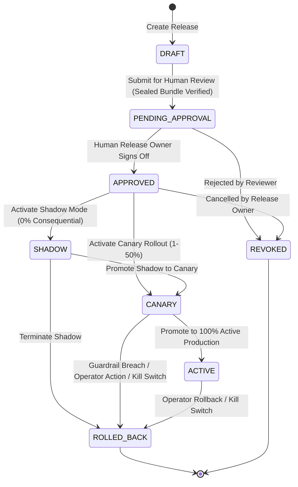

# ADR-0011: Milestone 11 — Versioned Policy Canary, Release Control & Automated Rollback (Feature E6)

* **Status:** Accepted (Hardened via EGM Multi-Persona Adversarial Review: `egm-design`, `egm-implementation-readiness`, `egm-zoom-out`)
* **Date:** 2026-11-08
* **Authors:** OpsBlaze Architecture & Agentic AI Reliability Engineering
* **Capabilities Covered:**
  * `E6` — Versioned Policy Canary and Rollback
* **Depends On:**
  * [`0001-b1-durable-incident-workflow.md`](file:///c:/Users/prana/OneDrive/Desktop/OpsBlaze/docs/adr/0001-b1-durable-incident-workflow.md)
  * [`0002-e8-adapter-conformance-and-chaos-lab.md`](file:///c:/Users/prana/OneDrive/Desktop/OpsBlaze/docs/adr/0002-e8-adapter-conformance-and-chaos-lab.md)
  * [`0003-b2-version-fenced-resource-reservation.md`](file:///c:/Users/prana/OneDrive/Desktop/OpsBlaze/docs/adr/0003-b2-version-fenced-resource-reservation.md)
  * [`0004-b3-effect-receipt-and-reconciliation.md`](file:///c:/Users/prana/OneDrive/Desktop/OpsBlaze/docs/adr/0004-b3-effect-receipt-and-reconciliation.md)
  * [`0005-stage4-durable-integrity-and-cross-store-recovery.md`](file:///c:/Users/prana/OneDrive/Desktop/OpsBlaze/docs/adr/0005-stage4-durable-integrity-and-cross-store-recovery.md)
  * [`0006-stage5-adaptive-investigation-and-evidence-engine.md`](file:///c:/Users/prana/OneDrive/Desktop/OpsBlaze/docs/adr/0006-stage5-adaptive-investigation-and-evidence-engine.md)
  * [`0007-stage6-operator-control-plane-and-evaluation-engine.md`](file:///c:/Users/prana/OneDrive/Desktop/OpsBlaze/docs/adr/0007-stage6-operator-control-plane-and-evaluation-engine.md)
  * [`0008-stage7-experience-capture-and-outcome-adjudication.md`](file:///c:/Users/prana/OneDrive/Desktop/OpsBlaze/docs/adr/0008-stage7-experience-capture-and-outcome-adjudication.md)
  * [`0009-stage8-failure-taxonomy-and-validated-lessons.md`](file:///c:/Users/prana/OneDrive/Desktop/OpsBlaze/docs/adr/0009-stage8-failure-taxonomy-and-validated-lessons.md)
  * [`0010-stage9-candidate-incumbent-regression-gate.md`](file:///c:/Users/prana/OneDrive/Desktop/OpsBlaze/docs/adr/0010-stage9-candidate-incumbent-regression-gate.md)

---

## 1. Context and Problem Statement

Following Milestone 9, OpsBlaze maintains an offline statistical regression gate (`E5`) that evaluates candidate prompt changes, budget allocations, and validated lessons against frozen holdouts. However, offline holdouts cannot account for the real-world entropy, network jitter, adapter edge cases, and continuous domain drift of live production incidents.

Directly cutting over live traffic to newly evaluated candidate policies presents severe operational risk:
1. An agent policy may exhibit unpredicted latency spikes or token runaway under production load.
2. An agent could misinterpret ambiguous live telemetry, attempting unauthorized or unsafe mutations.
3. In-flight incidents could experience state corruption if policies switch dynamically mid-investigation.
4. Without immutable cryptographic identity, tracking whether an incident was resolved by an incumbent or a candidate policy is impossible.

Feature `E6` (Versioned Policy Canary and Rollback) establishes an immutable, signed, human-governed deployment pipeline:
$$\text{E3 Proposal} \longrightarrow \text{E4 Validated Lesson} \longrightarrow \text{E5 Regression Gate} \longrightarrow \text{E6 Release Approval} \longrightarrow \text{Shadow} \longrightarrow \text{Canary} \longrightarrow \text{Active / Automated Rollback}$$

### Fundamental Governance Law
**The model must never directly activate a candidate, change production policy, expand its own permissions, or authorize its own deployment.** All release transitions require cryptographically verifiable bundles, server-derived human principal authorization, deterministic cohort assignment, runtime safety guardrails, and fail-safe fallback to the pinned incumbent baseline.

---

## 2. Non-Negotiable Invariants & Authority Boundaries

| Invariant ID | Rule Description | Enforcement Location |
|---|---|---|
| **INV-E6-1** | **Immutable Signed Policy Bundle** | Every release references an immutable bundle capturing exact versions of base policy, candidate changes, prompt templates, model ID/version, tool catalog, A2 grants, validated E4 lessons, E5 report reference, and target adapter digest. Sealing uses RFC 8785 canonical JSON and digital signing with length-prefixed domain separation: $\text{HMAC-SHA256}(D_{\text{bundle}} \parallel \text{len}(T) \parallel T \parallel \text{KeyID} \parallel \text{Epoch})$. Tampered or modified bundles fail closed. |
| **INV-E6-2** | **Strict E5 Release Eligibility Gate** | A release cannot be created, approved, or activated unless its candidate policy holds a completed E5 evaluation with verdict `PASS`, accepted human review, matching report digest, and active source outcome/consent. (Exception: initial bootstrap incumbent v1.0.0 allowed with `source_manifest_id IS NULL`). A historical PASS is invalidated if underlying source evidence is revoked. |
| **INV-E6-3** | **Server-Derived Release Authority & Separation of Duties** | Release creation, approval, activation, rollback, and kill-switch actions require a verified human principal (`actor_kind = 'HUMAN'`). The release approver must hold role `release_owner` or `incident_commander` and must be distinct from the release drafter (`drafter_id <> reviewer_id`, enforced by DB constraint). Autonomous systems and models are strictly forbidden from release authority. |
| **INV-E6-4** | **Decoupled 8-State Release Machine & Single Active Release** | Release state transitions strictly follow: `DRAFT -> PENDING_APPROVAL -> APPROVED -> SHADOW -> CANARY -> ACTIVE -> ROLLED_BACK` (with `REVOKED` from `PENDING_APPROVAL` or `APPROVED`). Single active release per component enforced by partial unique index `(tenant_id, target_component) WHERE state IN ('SHADOW', 'CANARY', 'ACTIVE')`. |
| **INV-E6-5** | **Isolated Shadow Mode (Consequential Protection)** | Shadow deployments execute candidate reasoning in an isolated non-blocking observation path. The incumbent retains 100% consequential authority. Candidate actions are strictly prevented from reaching the B3 effect gateway, acquiring B2 fences, or emitting P2 approval cockpit cards. Outcomes are compared offline via independent oracle. |
| **INV-E6-6** | **Deterministic Stable Canary Cohort Assignment** | Live incident assignment uses a stable consistent hashing algorithm: $\text{SHA-256}(T \parallel \text{target\_id} \parallel \text{salt} \parallel \text{incident\_id}) \pmod{100} < \text{canary\_percentage}$. Assignments are immutable, retry-safe, and independent of model output. |
| **INV-E6-7** | **Active-Run Policy Pinning via Lean Inlined Schema** | At admission, every incident resolves and permanently records its `pinned_policy_bundle_id`, `policy_release_id`, `canary_arm`, and `assignment_hash_val` directly on table `incident`. In-flight investigations never switch policy mid-run when release configuration changes. Normal rollback affects only future admissions. |
| **INV-E6-8** | **Two-Tier Canary Safety Guardrails & Decoupled Rollback** | **Class 1 (Zero-Tolerance Invariant Breaches):** $N=1$ on unauthorized mutation, negative-control breach, or fence violation triggers immediate atomic rollback to `ROLLED_BACK`. **Class 2 (Statistical Rate Metrics):** Evaluated over minimum sample size $N_{\min} \ge 30$, relative risk $RR > 1.5$ and error rate $> 5\%$ vs concurrent incumbent baseline before triggering rollback. |
| **INV-E6-9** | **Emergency Release Kill Switch & Fail-Safe Invalidation** | Operators can trigger an instantaneous release kill switch (`kill_switch_active = true`). Routes 100% of new admissions to `incumbent_bundle_id`. In-flight candidate investigations are safely halted from consequential mutation at the server-side P2 approval and B2 reservation gateways, moving the incident to `ESCALATED_TO_HUMAN`. Fail-closed if release control plane is unavailable. |
| **INV-E6-10** | **Append-Only Auditable Release Ledger** | Every state transition, approval, assignment, guardrail breach, rollback, and kill switch event is recorded in PostgreSQL table `release_event_audit` with immutable timestamps, actor IDs, and cryptographic digests. |

---

## 3. Cryptographic Policy Bundle Design

A policy bundle seals all operational parameters into an immutable artifact:

```json
{
  "bundle_name": "prod-k8s-reconciliation-v2",
  "base_policy_version": "v1.0.0",
  "target_component": "investigator_a1_prompt",
  "proposal_diff": {
    "template_name": "prompt_v1",
    "section_name": "reconciliation_guidelines",
    "original_text": "Verify cart session.",
    "proposed_text": "Always verify cart session lock before releasing read reservation."
  },
  "active_lesson_ids": ["c1a2b3c4-0000-0000-0000-000000000001"],
  "model_id": "gemini-2.0-flash",
  "model_version": "v1.0",
  "tool_catalog_version": "v1",
  "a2_grant_version": "v1",
  "source_manifest_id": "a1b2c3d4-e5f6-7890-abcd-ef1234567890",
  "source_report_id": "b2c3d4e5-f6a7-8901-bcde-f12345678901",
  "source_provenance_digest": "3a4b5c6d..."
}
```

### Sealing & Signature Protocol
1. **RFC 8785 Canonical Serialization:** Keys sorted alphabetically, whitespace stripped, Unicode normalized (NFC).
2. **Digest Computation:** $D_{\text{bundle}} = \text{SHA-256}(\text{CanonicalJSON})$.
3. **Digital Signature with Domain Separation:**
   $$\text{SigningInput} = D_{\text{bundle}} \parallel \text{len}(T) \parallel T \parallel \text{len}(\text{KeyID}) \parallel \text{KeyID} \parallel \text{Epoch}$$
   $$\sigma_{\text{bundle}} = \text{HMAC-SHA256}_{K_{\text{secret}}}(\text{SigningInput})$$
4. **Immutability Enforcement:** Once sealed (`status = 'SEALED'`), database triggers and repository CAS reject any `UPDATE` statements targeting bundle contents.

---

## 4. Release State Machine & Atomic CAS Transitions



### Authoritative CAS Transition Matrix

| From State | Action / Transition | Allowed Principal Role | Separation of Duties | CAS SQL Precondition (`WHERE`) | To State | Side Effects & Invariants |
|---|---|---|---|---|---|---|
| `*` (none) | `create_release` | `platform_engineer`, `evaluation_owner`, `incident_commander` | None | New row insertion | `DRAFT` | Verifies bundle is `SEALED` and E5 report is `PASS` |
| `DRAFT` | `submit_for_approval` | `platform_engineer`, `evaluation_owner` | None | `WHERE id=:id AND tenant_id=:t AND version=:v AND state='DRAFT'` | `PENDING_APPROVAL` | Re-checks E5 eligibility; locks release parameters |
| `PENDING_APPROVAL` | `approve_release` | `release_owner`, `incident_commander` | `actor_id <> drafter_id` | `WHERE id=:id AND tenant_id=:t AND version=:v AND state='PENDING_APPROVAL'` | `APPROVED` | Sets `reviewer_id`, `approved_at`, version increment |
| `PENDING_APPROVAL` | `reject_release` | `release_owner`, `incident_commander` | None | `WHERE id=:id AND tenant_id=:t AND version=:v AND state='PENDING_APPROVAL'` | `REVOKED` | Sets `revocation_reason`, version increment |
| `APPROVED` | `activate_shadow` | `release_owner`, `incident_commander` | None | `WHERE id=:id AND tenant_id=:t AND version=:v AND state='APPROVED'` | `SHADOW` | Enforces single active release per component; `canary_pct=0` |
| `APPROVED` | `activate_canary` | `release_owner`, `incident_commander` | None | `WHERE id=:id AND tenant_id=:t AND version=:v AND state='APPROVED'` | `CANARY` | Enforces single active release per component; `canary_pct=1..50` |
| `SHADOW` | `promote_to_canary`| `release_owner`, `incident_commander` | None | `WHERE id=:id AND tenant_id=:t AND version=:v AND state='SHADOW'` | `CANARY` | Sets `canary_percentage = :pct`, version increment |
| `SHADOW` | `terminate_shadow` | `release_owner`, `incident_commander`, `operator` | None | `WHERE id=:id AND tenant_id=:t AND version=:v AND state='SHADOW'` | `ROLLED_BACK` | Sets `rolled_back_at`, `rollback_reason='OPERATOR_TERMINATED'` |
| `CANARY` | `promote_to_active`| `release_owner`, `incident_commander` | None | `WHERE id=:id AND tenant_id=:t AND version=:v AND state='CANARY'` | `ACTIVE` | Sets `canary_percentage=100`, version increment |
| `CANARY` | `trigger_rollback` | Any human operator / Guardrail Service | None | `WHERE id=:id AND tenant_id=:t AND version=:v AND state='CANARY'` | `ROLLED_BACK` | Atomic single-tx rollback; records rollback trigger |
| `ACTIVE` | `trigger_rollback` | Any human operator / Guardrail Service | None | `WHERE id=:id AND tenant_id=:t AND version=:v AND state='ACTIVE'` | `ROLLED_BACK` | Atomic single-tx rollback; traffic falls back to incumbent |
| `*` (Any active) | `trip_kill_switch` | Any human operator (`operator`, `sre_lead`, etc.) | None | `WHERE id=:id AND tenant_id=:t AND state IN ('SHADOW','CANARY','ACTIVE')` | `ROLLED_BACK` | Sets `kill_switch_active=true`; invalidates B2/P2 gates |

---

## 5. Lean Database Schema (Additive PostgreSQL)

Milestone 11 introduces 3 lean tables and 4 additive columns on `incident`, eliminating the need for a separate assignment table:

```sql
-- 1. Immutable Signed Policy Bundle
CREATE TABLE policy_bundle (
    id UUID PRIMARY KEY,
    tenant_id UUID NOT NULL REFERENCES tenant(id) ON DELETE CASCADE,
    version INTEGER NOT NULL DEFAULT 1,
    bundle_name VARCHAR(128) NOT NULL,
    bundle_sha256 VARCHAR(64) NOT NULL,
    signature VARCHAR(128) NOT NULL,
    signature_key_id VARCHAR(64) NOT NULL,
    base_policy_version VARCHAR(64) NOT NULL,
    target_component VARCHAR(64) NOT NULL,
    proposal_diff JSONB,
    prompt_templates JSONB,
    active_lesson_ids JSONB,
    model_id VARCHAR(64) NOT NULL,
    model_version VARCHAR(64) NOT NULL,
    tool_catalog_version VARCHAR(64) NOT NULL,
    a2_grant_version VARCHAR(64) NOT NULL,
    source_manifest_id UUID REFERENCES candidate_evaluation_manifest(id) ON DELETE RESTRICT,
    source_report_id UUID REFERENCES candidate_evaluation_report(id) ON DELETE RESTRICT,
    source_provenance_digest VARCHAR(64) NOT NULL,
    status VARCHAR(32) NOT NULL DEFAULT 'DRAFT', -- 'DRAFT', 'SEALED', 'ARCHIVED'
    created_by VARCHAR(128) NOT NULL,
    created_at TIMESTAMP WITH TIME ZONE NOT NULL DEFAULT NOW(),
    sealed_at TIMESTAMP WITH TIME ZONE,
    CONSTRAINT uq_policy_bundle_tenant UNIQUE (tenant_id, id),
    CONSTRAINT uq_policy_bundle_digest UNIQUE (tenant_id, bundle_sha256)
);

CREATE INDEX idx_policy_bundle_target ON policy_bundle(tenant_id, target_component, status);

-- 2. Mutable Governed Policy Release
CREATE TABLE policy_release (
    id UUID PRIMARY KEY,
    tenant_id UUID NOT NULL REFERENCES tenant(id) ON DELETE CASCADE,
    version INTEGER NOT NULL DEFAULT 1,
    target_component VARCHAR(64) NOT NULL,
    bundle_id UUID NOT NULL,
    incumbent_bundle_id UUID NOT NULL,
    state VARCHAR(32) NOT NULL DEFAULT 'DRAFT',
    canary_percentage INTEGER NOT NULL DEFAULT 0 CHECK (canary_percentage >= 0 AND canary_percentage <= 100),
    rollout_salt VARCHAR(64) NOT NULL,
    drafter_id VARCHAR(128) NOT NULL,
    reviewer_id VARCHAR(128),
    reviewer_role VARCHAR(64),
    decision_comments VARCHAR(2000),
    kill_switch_active BOOLEAN NOT NULL DEFAULT FALSE,
    kill_switch_triggered_by VARCHAR(128),
    kill_switch_triggered_at TIMESTAMP WITH TIME ZONE,
    rollback_reason VARCHAR(1024),
    created_at TIMESTAMP WITH TIME ZONE NOT NULL DEFAULT NOW(),
    updated_at TIMESTAMP WITH TIME ZONE NOT NULL DEFAULT NOW(),
    approved_at TIMESTAMP WITH TIME ZONE,
    activated_at TIMESTAMP WITH TIME ZONE,
    rolled_back_at TIMESTAMP WITH TIME ZONE,
    CONSTRAINT uq_policy_release_tenant UNIQUE (tenant_id, id),
    CONSTRAINT fk_policy_release_bundle FOREIGN KEY (tenant_id, bundle_id) REFERENCES policy_bundle(tenant_id, id) ON DELETE RESTRICT,
    CONSTRAINT fk_policy_release_incumbent FOREIGN KEY (tenant_id, incumbent_bundle_id) REFERENCES policy_bundle(tenant_id, id) ON DELETE RESTRICT,
    CONSTRAINT chk_release_separation_of_duties CHECK (reviewer_id IS NULL OR drafter_id <> reviewer_id)
);

-- Partial Unique Index: Single Active Release per Target Component
CREATE UNIQUE INDEX uq_active_release_per_target 
ON policy_release (tenant_id, target_component) 
WHERE state IN ('SHADOW', 'CANARY', 'ACTIVE');

-- 3. Append-Only Release Audit Trail
CREATE TABLE release_event_audit (
    id UUID PRIMARY KEY,
    tenant_id UUID NOT NULL REFERENCES tenant(id) ON DELETE CASCADE,
    release_id UUID NOT NULL REFERENCES policy_release(id) ON DELETE CASCADE,
    event_type VARCHAR(64) NOT NULL,
    from_state VARCHAR(32),
    to_state VARCHAR(32) NOT NULL,
    actor_id VARCHAR(128) NOT NULL,
    actor_role VARCHAR(64) NOT NULL,
    metadata_redacted JSONB NOT NULL DEFAULT '{}'::jsonb,
    created_at TIMESTAMP WITH TIME ZONE NOT NULL DEFAULT NOW()
);

CREATE INDEX idx_release_audit_release ON release_event_audit(tenant_id, release_id, created_at);

-- 4. Additive Incident Assignment Columns on Table 'incident'
ALTER TABLE incident ADD COLUMN pinned_policy_bundle_id UUID REFERENCES policy_bundle(id) ON DELETE RESTRICT;
ALTER TABLE incident ADD COLUMN policy_release_id UUID REFERENCES policy_release(id) ON DELETE RESTRICT;
ALTER TABLE incident ADD COLUMN canary_arm VARCHAR(32); -- 'INCUMBENT', 'CANDIDATE'
ALTER TABLE incident ADD COLUMN assignment_hash_val INTEGER;

CREATE INDEX idx_incident_pinned_bundle ON incident(tenant_id, pinned_policy_bundle_id);
```

---

## 6. Deterministic Cohort Assignment Algorithm

```python
def assign_incident_cohort(
    *,
    tenant_id: uuid.UUID,
    incident_id: uuid.UUID,
    target_id: str,
    release: PolicyRelease | None,
    default_incumbent_bundle_id: uuid.UUID,
) -> tuple[str, uuid.UUID, int | None]:
    """Deterministically assigns an admitted incident to INCUMBENT or CANDIDATE arm.

    Uses canonical attributes: tenant_id, target_id, rollout_salt, incident_id.
    """
    if release is None or release.kill_switch_active or release.state not in ("SHADOW", "CANARY", "ACTIVE"):
        return ("INCUMBENT", default_incumbent_bundle_id, None)

    if release.state == "ACTIVE":
        return ("CANDIDATE", release.bundle_id, 100)

    if release.state == "SHADOW":
        # Incumbent executes consequential path; candidate shadows asynchronously
        return ("INCUMBENT", release.incumbent_bundle_id, 0)

    # CANARY State: Consistent Hashing
    seed_str = f"{tenant_id}:{target_id}:{release.rollout_salt}:{incident_id}"
    digest = hashlib.sha256(seed_str.encode("utf-8")).digest()
    hash_int = int.from_bytes(digest[:8], byteorder="big")
    percentile = hash_int % 100

    if percentile < release.canary_percentage:
        return ("CANDIDATE", release.bundle_id, percentile)
    return ("INCUMBENT", release.incumbent_bundle_id, percentile)
```

---

## 7. Complete REST API Contract (`/v1/releases`)

Every mutation endpoint enforces atomic CAS optimistic concurrency (`expected_version: int`) and server-side principal verification.

| HTTP Verb & Path | Description | Required Principal Role | Request Model | Response Model |
|---|---|---|---|---|
| `GET /v1/releases` | List releases for tenant | Any authenticated | Query: `target_component`, `limit` | `list[PolicyReleaseResponse]` |
| `GET /v1/releases/{id}` | Fetch release detail & audit | Any authenticated | None | `PolicyReleaseDetailResponse` |
| `POST /v1/releases` | Create new draft release | `platform_engineer`, `evaluation_owner`, `incident_commander` | `ReleaseCreateRequest` | `PolicyReleaseResponse` |
| `POST /v1/releases/{id}/submit` | Submit draft for human approval | `platform_engineer`, `evaluation_owner` | `ReleaseSubmitRequest` | `PolicyReleaseResponse` |
| `POST /v1/releases/{id}/approve` | Review release (Approve/Reject) | `release_owner`, `incident_commander` (drafter $\neq$ reviewer) | `ReleaseReviewRequest` | `PolicyReleaseResponse` |
| `POST /v1/releases/{id}/activate-shadow` | Activate shadow mode (0%) | `release_owner`, `incident_commander` | `ReleaseActivateShadowRequest` | `PolicyReleaseResponse` |
| `POST /v1/releases/{id}/activate-canary` | Activate canary (1–50%) | `release_owner`, `incident_commander` | `ReleaseActivateCanaryRequest` | `PolicyReleaseResponse` |
| `POST /v1/releases/{id}/promote-active` | Promote canary to active (100%) | `release_owner`, `incident_commander` | `ReleasePromoteActiveRequest` | `PolicyReleaseResponse` |
| `POST /v1/releases/{id}/rollback` | Rollback release to incumbent | Any operator (`sre_lead`, `operator`, `release_owner`) | `ReleaseRollbackRequest` | `PolicyReleaseResponse` |
| `POST /v1/releases/{id}/kill-switch` | Emergency release kill switch | Any operator | `ReleaseKillSwitchRequest` | `PolicyReleaseResponse` |
| `POST /v1/bundles` | Create draft policy bundle | `platform_engineer`, `evaluation_owner` | `PolicyBundleCreateRequest` | `PolicyBundleResponse` |
| `POST /v1/bundles/{id}/seal` | Seal & cryptographically sign bundle | `platform_engineer`, `evaluation_owner` | `PolicyBundleSealRequest` | `PolicyBundleResponse` |
| `GET /v1/bundles` | List policy bundles | Any authenticated | Query: `target_component`, `status` | `list[PolicyBundleResponse]` |
| `GET /v1/bundles/{id}` | Inspect policy bundle | Any authenticated | None | `PolicyBundleResponse` |

---

## 8. Frontend Architecture (`ReleaseControlView.tsx`)

The React TSX interface provides comprehensive visualization and human control:
- **Active Release Summary Banner:** Displays current target component rollout state (`SHADOW`, `CANARY (X%)`, `ACTIVE`, `ROLLED_BACK`), active bundle digests, and signature verification status.
- **Rollout Controls:** One-click promotion to shadow, canary with percentage slider (1–50%), and 100% active promotion with atomic version checks.
- **Emergency Kill Switch:** Prominent high-contrast red kill-switch control requiring explicit operator rationale.
- **Canary Guardrail Telemetry:** Real-time metrics comparing incumbent vs candidate error rates, latency, mutation attempts, and zero-tolerance violations.
- **Immutable Release Audit Log:** Chronological table displaying all state transitions, actors, and cryptographic digests.
