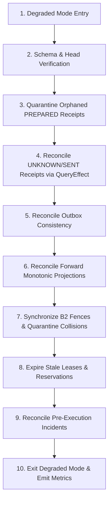

# OpsBlaze Runbook: Cross-Store Recovery Protocol & Degraded Mode Operations

## 1. Context & Purpose
OpsBlaze coordinates state across two independent authorities: PostgreSQL (transactional domain records) and Temporal (durable workflow histories).
When either store is restored from backup, experiences process crashes, or restarts out-of-sync with live external target systems, state divergence can occur:
- **Scenario A:** PostgreSQL behind Temporal (e.g. PG restored to an earlier point in time while Temporal already ran to `AWAITING_APPROVAL` or `VERIFIED`).
- **Scenario B:** Temporal behind PostgreSQL or empty (e.g. Temporal server reset or lost history while PG has committed receipts).
- **Scenario C:** Independent divergent restores with live external target ahead (e.g. target saw higher fences or external mutations).

The `CrossStoreRecoveryCoordinator` (`backend.workflows.recovery`) executes a deterministic, idempotent 10-step protocol to reconcile all discrepancies.

---

## 2. The 10-Step Recovery Protocol



### Protocol Steps:
1. **Enter Degraded Mode:** Activate `DegradedRecoveryGate`. Reject new mutations (`POST /api/incidents/.../execute`) and pause outbox dispatch. Read-only investigations remain available.
2. **Schema & Alembic Head Verification:** Validate all required tables and verify Alembic revision matches expected migration heads (`stage3_002_b2_b3_e8`).
3. **Quarantine Orphaned PREPARED Receipts:** Receipts in `PREPARED` older than 60 seconds with no corresponding active mutation permit or dispatch activity are transitioned to `NEEDS_REVIEW`.
4. **Reconcile Pending Receipts via `EffectReconciler`:** Query target adapters for any receipts in `UNKNOWN` or `SENT`:
   - If `COMMITTED`: advance to `CONFIRMED` / `VERIFIED`.
   - If `NOT_FOUND`: transition to `NEEDS_REVIEW` (never `FAILED` or re-dispatched).
5. **Reconcile Outbox Consistency:** Ensure every non-terminal incident has an undelivered outbox row; mark outbox delivered for already terminal incidents.
6. **Workflow Alignment (Scenario A):** If Temporal workflow is ahead of PostgreSQL, advance PostgreSQL status forward monotonically without regressing (`ACCEPTED -> INVESTIGATING -> AWAITING_APPROVAL -> VERIFIED`).
7. **Synchronize B2 Epochs & Reservations (Scenario C):**
   - Compute fence watermark: `max(epoch.latest_fence, target.highest_fence_seen, max(reservations), max(receipts))`.
   - Update `resource_epoch.latest_fence = watermark`.
   - Invariant R4: If target mutated ahead out-of-band, expire conflicting reservations (`fence <= highest_fence_seen`) and quarantine holder incident to `NEEDS_REVIEW`.
8. **Expire Stale Leases & Reservations:** Expire orphaned `RESERVED` or `DISPATCHED` records whose receipts have reached terminal states.
9. **Reconcile Pre-Execution Workflows (Scenario B):** Incidents at `AWAITING_APPROVAL` with no active Temporal workflow have their status reset to `DISPATCH_PENDING` and outbox undelivered, allowing clean redispatch.
10. **Exit Degraded Mode:** Deactivate `DegradedRecoveryGate` and return comprehensive `RecoveryReport`.

---

## 3. Manual Recovery Triggering
Run recovery programmatically or via operator CLI:
```python
from backend.persistence.db import get_engine, make_session_factory
from backend.workflows.recovery import CrossStoreRecoveryCoordinator

engine = get_engine()
session_factory = make_session_factory(engine)
coordinator = CrossStoreRecoveryCoordinator(session_factory)

report = await coordinator.run_recovery(
    adapters=active_adapters,
    temporal_workflows=temporal_snapshots,
    tenant_id=tenant_id,
)
print("Recovery completed. Degraded mode exited:", report.degraded_mode_exited)
```
